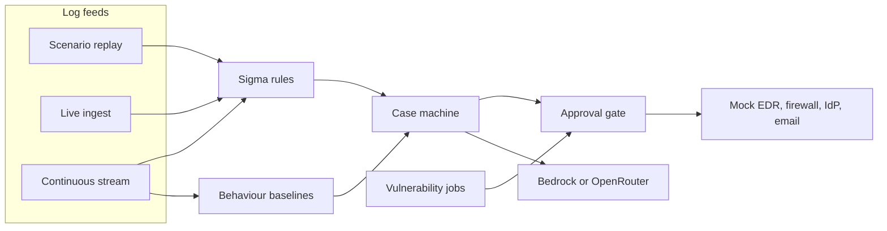

# AutoSOC

A security operations loop you can run on a laptop: raw logs become a case, a language model investigates and proposes a response, and a person approves only the actions that can disrupt a host, a user, or the network.

The company is fictional. The EDR, firewall, identity provider, email gateway, and ticketing system are mocks. The model is a real API (Amazon Bedrock, with OpenRouter as a fallback). With no key, the same path runs offline and the scenarios become tests.

## The problem

An alert does not get contained by the tool that raised it. Someone has to pull the surrounding logs, decide whether the activity is malicious, pick a response, and wait for approval before anything that could isolate a server or disable an account. That handoff is where time goes, and it is hard to demonstrate: a realistic walkthrough needs a SIEM, endpoint tooling, a firewall, and an identity provider, all wired together.

AutoSOC is that handoff, in one process, with attacks that are safe to run.

## What you can show with it

- **A scripted attack, end to end.** Replay SSH brute force, encoded PowerShell, credential dumping, a new local admin, scheduled-task persistence, phishing, or an exploit attempt. Each scenario states the verdict and the response it should produce.
- **A live log feed.** Point a shipper at `POST /ingest` (JSON) or `POST /ingest/syslog` (BSD syslog). The brute-force scenario can be streamed in faster than real time and opens the same kind of case as a replay.
- **A mixed stream, which is the presentation demo.** Normal activity from many hosts, with an attack injected on a timer. Some injections are synthetic. Others are real Windows and Sysmon captures from the [OTRF Security-Datasets](https://github.com/OTRF/Security-Datasets) (Mimikatz, LSASS dump via comsvcs, scheduled tasks, a WMIC backdoor account, local-admin discovery, PsExec, BITS, mshta). A scoreboard compares what was injected with what was caught.
- **Vulnerability management on the same approval gate.** Assets, findings, risk scores, tickets, and remediation run beside the SOC cases. Disruptive patch and control changes wait for the same kind of approval as an isolate-host action.

## How a case moves



Every feed stores the event, runs the Sigma rules, and hands an alert to the same case machine: dedupe, enrich (threat intel, asset inventory, open findings), triage, investigate, plan a response, then the gate. The stream also scores behaviour baselines (a login from a new network, a rare process, a first-time host, an admin action outside business hours) and groups related cases into an incident.

The case machine calls the model for triage, investigation, response planning, and the write-up. Tool calls that change state go out through the gate to the mocks. Low-impact steps run immediately. Higher tiers wait.

| Tier | What happens |
|---|---|
| 0–1 | Runs as soon as the playbook is submitted |
| 2 | Waits for one approver. A few malware-playbook steps skip that wait when the verdict is malicious and confidence is at least 0.95 |
| 3 | Needs an analyst and a SOC lead |

The gate starts from the tier written on the playbook step and will only raise it (low confidence, a critical asset, thin evidence, an admin or executive user, a server, or an explicit request from the response agent). Vulnerability remediation can arrive with a tier already chosen for that job.

On the stream, incidents get a separate 0–100 severity score for the Live SOC ranking. That score does not pick the approval tier. The playbook does.

## Run it

Requires Python 3.12.

```bash
uv venv --python 3.12 .venv && uv pip install --python .venv/bin/python -r requirements.txt
cp .env.example .env          # add AWS_BEARER_TOKEN_BEDROCK, or set LLM_PROVIDER=offline
```

### 1. Replay one attack

No server. This is the fastest way to see a case.

```bash
.venv/bin/python -m autosoc list
.venv/bin/python -m autosoc run ssh-bruteforce-01 --fresh
```

Add `--approve` to auto-approve tier 2 and 3 so the case can close. Leave it off when you want the case to stop at **Awaiting approval**.

### 2. Watch it in the dashboard

```bash
.venv/bin/streamlit run ui/app.py
```

Open http://localhost:8501. The sidebar name defaults to `ana` and the role to **analyst**. Switch to **soc_lead** when a tier-3 action needs the second approval.

| Tab | What it is for |
|---|---|
| Overview | Replay a scenario from the UI and read the last run's metrics |
| Live SOC | Incidents ranked by severity, and the live event stream |
| Scoreboard | Injected attacks versus what the stream caught, synthetic and real |
| Cases | Verdict, timeline, and planned or executed actions |
| Approvals | Pending actions for the signed-in role |
| Vulnerabilities | Findings, risk, and tickets |
| Audit | Prompts, tool calls, and decisions |

### 3. Send logs the way a shipper would

Terminal A:

```bash
.venv/bin/python -m autosoc mocks
```

Terminal B, while the server is up:

```bash
.venv/bin/python tools/send_logs.py scenarios/soc/01_ssh_bruteforce.yml --speed 5
```

`mocks` serves the tool APIs and the ingest feed on http://127.0.0.1:8000. The sender posts ECS JSON to `/ingest`. A path that is not `.yml`, `.yaml`, or `.jsonl` is treated as raw syslog and posted to `/ingest/syslog`. If the connection is refused, the mocks server is not running.

Open **Live SOC** while the events arrive. Rows that match a rule are marked, and the brute-force case shows up under **Cases** with the same verdict and actions as the replay.

Alerts from the live feed wait until the host and source IP (or host and user) have been quiet for 10 seconds, and at most 120 seconds, so a brute force is not judged before the successful login that follows it. Replay hands the agents the whole window at once. `INGEST_SETTLE_QUIET_S` and `INGEST_SETTLE_MAX_S` change the live wait.

### 4. The presentation stream

A fifteen-minute speaker script is in [DEMO_streaming.md](DEMO_streaming.md). The short version:

```bash
# terminal 1
.venv/bin/streamlit run ui/app.py

# terminal 2
.venv/bin/python -m autosoc stream --rate 5 --interval 30 --fresh
```

That is about 5 benign events per second and one attack every 30 seconds. Leave **Live SOC** open, then **Scoreboard** for what was caught and what was missed. The stream settles alerts after 6 seconds of quiet, or 45 seconds at most. Baselines and incident grouping run on this feed.

The eight OTRF captures ship in `data/datasets/otrf/` so the real-attack injections work without a download. They are lab telemetry published by the Open Threat Research Forge for detection research, not data from this project.

## Commands

| Command | What it does |
|---|---|
| `python -m autosoc list` | List SOC and VM scenarios |
| `python -m autosoc run <id> [--approve] [--fresh]` | Replay one scenario |
| `python -m autosoc run-all [--kind soc\|vm] [--approve]` | Every scenario on a clean database, then the summary metrics |
| `python -m autosoc metrics` | Print metrics from runs already stored |
| `python -m autosoc vm-cycle` | Run the vulnerability-management jobs once |
| `python -m autosoc scheduler` | Asset sync, scan, VM agent, remediation, verify, SLA, exception expiry, weekly report, and approval escalation |
| `python -m autosoc mocks [--host 0.0.0.0] [--port 8000]` | Mock tool APIs and the live ingest feed |
| `python -m autosoc stream [--rate 5] [--interval 30] [--fresh]` | Continuous mixed feed |
| `python -m autosoc reset` | Wipe runtime state |
| `python tools/send_logs.py <file> [--speed N]` | Stream a scenario, a syslog file, or JSONL to `/ingest` |
| `python -m pytest` | 33 tests: every scenario, ingest, the stream, and the guardrails. Offline and deterministic |

## Ingest API

Served by `python -m autosoc mocks`. Use `--host 0.0.0.0` to accept logs from another machine. Set `MOCK_BASE_URL=http://127.0.0.1:8000` when the agents should call the tool APIs over HTTP. Leave it empty and they call the same app in-process.

| Endpoint | Body |
|---|---|
| `POST /ingest` | One ECS event or a JSON array. Nested `{"source": {"ip": ...}}`, dotted keys, or the scenario's short aliases. `@timestamp` may be ISO-8601 or epoch; if it is missing, the server uses ingest time |
| `POST /ingest/syslog` | Raw text, one BSD-syslog line per event. sshd `Failed password` and `Accepted password` / `publickey` become `ssh_login_failed` / `ssh_login_success` with `user.name` and `source.ip`. Other lines are stored as `syslog_message` |
| `GET /ingest/status` | Counters, alerts still settling, and cases opened from the live feed |
| `GET /health` | Process is up |

There is no page at `/`. A browser opening the port, or Chrome probing `/json/version`, gets a 404. That is the tool API, not a website.

In production the collector would be Winlogbeat, a Wazuh agent, auditbeat, Vector, or Fluent Bit, and a SIEM would usually raise the alert. `/ingest` is here so the whole chain is visible in one process: store the event, run the rules, open the case.

## Guardrails

- **Least privilege.** Each agent has a tool allowlist. Only the playbook runner calls APIs that change state.
- **Structured output.** Each agent's JSON is validated. Invalid output gets one retry, then the case is escalated.
- **Evidence.** A `malicious` verdict has to cite real event ids or malicious intel hits. Response parameters have to appear in the case facts.
- **Prompt injection.** Attacker-controlled fields are wrapped as `<untrusted>` and flagged. The encoded-PowerShell scenario hides "ignore previous instructions…" in the payload.
- **Budgets.** At most 20 tool calls and 5 LLM calls per alert. Identical prompts are cached. HTTP 429 and 5xx back off, then the next configured provider is tried.
- **Reversible and audited.** Every action records its rollback. Prompts, tool calls, and decisions land in the audit log.

## LLM providers

`LLM_PROVIDER=bedrock` is the default. The client uses the Bedrock Converse API with `AWS_BEARER_TOKEN_BEDROCK` in `AWS_REGION` (the example env uses `ap-southeast-2`). `BEDROCK_MODEL` in `.env.example` is Claude Haiku. Set it to `au.anthropic.claude-sonnet-4-6` when that model is enabled on the account and you want the stronger analyst. Short-term Bedrock keys expire after about 12 hours.

If Bedrock fails and `OPENROUTER_API_KEY` is set, OpenRouter is next. If neither can answer, the agents use a deterministic offline stand-in. `LLM_PROVIDER=offline` forces that stand-in. The tests do. The dashboard shows which provider answered each case.

## Layout

| Path | Contents |
|---|---|
| `scenarios/soc` | Eight attack scenarios, each with the outcome the test asserts |
| `scenarios/vm` | Nine vulnerability-management scenarios |
| `siem/rules` | Twelve Sigma-style detection rules |
| `playbooks` | Eight playbooks: steps, base tier, and when a step may run at high confidence. Rollback is per tool |
| `inventory`, `intel`, `vulns` | Mock CMDB and IdP, a threat-intel feed, and an NVD + EPSS + KEV snapshot with fictional CVE ids |
| `data/datasets/otrf` | OTRF captures used by the stream |
| `autosoc/agents` | Orchestrator, triage, investigation, response, reporting, VM agent |
| `autosoc/soar.py` | Playbook runner and the approval gate |
| `autosoc/vm` | Risk score (`CVSS × asset weight × exposure weight + 3·KEV + 5·EPSS`) and the lifecycle jobs |
| `autosoc/ingest.py` | `POST /ingest`, `POST /ingest/syslog`, `GET /ingest/status` |
| `autosoc/stream` | Mixed feed, baselines, OTRF adapter, incident correlation, scoreboard |
| `autosoc/mocks/app.py` | FastAPI mocks: `/intel`, `/edr`, `/firewall`, `/idp`, `/email`, `/tickets`, `/patch` |
| `tools/send_logs.py` | Shipper stand-in |
| `ui/app.py` | Streamlit dashboard |
| `tuning/suggestions` | Rule-tuning notes the reporting agent writes when a case closes. Generated locally, not part of the source tree |
| `DEMO_streaming.md` | Speaker script for the stream demo |

Runtime state lives in `data/autosoc.db` (gitignored). `.env` holds API keys and is gitignored. Copy `.env.example`.
