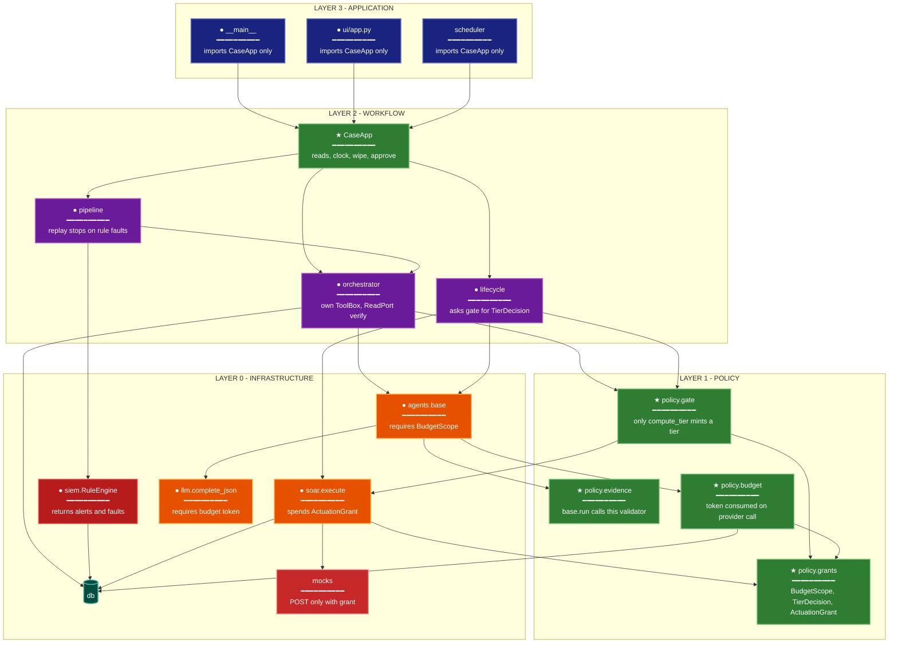

# Rectify: Policy bypass is unrepresentable

**Date:** 2026-10-17
**Investigation Reference:** `temp/investigate/investigation_autosoc_codebase_2026-10-17.md`

## Summary

AutoSOC already has the right policy functions: `compute_tier`, `_use_budget`, `ToolBox.call`, `ResponseClient.call`, and the per-agent validators. Callers can still act without them, because the arguments that mean "skip" are ordinary values: `case_id=None`, a `tier_override` tuple, a borrowed `ToolBox("triage")`, a public `http().post`, and `except Exception: continue`. The tests call the helpers directly, or they trust `pipeline.run()["passed"]`, which is computed by the same process that contains the bypass.

Immunity is a policy package whose grants cannot be built by workflow code. A tier, a budget charge, and a state-changing call each require a grant object constructed only inside that package. `None`, an override dict, and a raw POST stop being expressible. A rule that fails to match, a playbook step that cannot render, and a rule with no scenario become load or run failures, so the suite cannot stay green by never looking.

## How Tests Missed This

`tests/conftest.py` sets `LLM_PROVIDER=offline` before import. Cache lookup in `llm.complete_json` is skipped in that mode, so the budget increment in `base.run` (line 100, before `complete_json`) is never observed against a cache hit. `vm_agent.run` and `lifecycle.weekly_report` pass `case_id=None`, and `_use_budget` returns immediately. No VM scenario runs `job: report`. `vm-new-kev` only checks that a `kind=hunt` row exists; `kev_update` never calls an agent on that case, so the hunt exemption is never stressed.

`test_gate_never_lowers_tier_and_tier3_needs_two_roles` and `test_low_confidence_raises_tier` call `compute_tier` on a hand-built step with no `tier_override`. `plan_remediation` always sets `tier_override` and passes `ctx={}`. The VM scenarios then assert the tier `remediation_tier()` already chose (`vm-kev-web01` tier 3, `vm-patch-fails` tier 1). The oracle and the bypass agree with each other.

`test_soc_scenario` asserts `r["passed"]`. `evaluate_soc` treats a tool name on any action row, including `pending_approval`, as success (`actions_ok`). `policy_tier` drops actions whose only tier reason is "agent requested a higher tier", so an agent-only raise cannot fail `max_tier`. `test_approval_closes_the_loop` checks `status == "closed"` and `all_verified`. It does not read `report["final"]["close"]`. Offline `reporting._offline` sets `close` from the same predicate `_finish` uses, so the two writers cannot disagree under the suite.

`RuleEngine.process` swallowing match errors leaves happy-path scenarios detected. `siem/rules/data_exfiltration.yml` has no scenario, so that rule is loaded and never fired. `test_untrusted_fields_are_wrapped_and_flagged` calls `base.wrap` on one string. `test_agent_tool_allowlist` calls `ToolBox` as response and triage. Neither walks `orchestrator.verify` (`http().get` and a raw `events` query) or `ToolBox("triage")` constructed from the orchestrator.

The shared assumption: a green helper test means every caller uses the helper. The suite never asks "which modules are allowed to import this."

## Related Issues Found

Same shape, additional sites:

- `tools.ToolBox.call` skips the tool-call cap when `case_id` is missing. The VM allowlist `"vm"` is unused because `vm_agent` never builds a `ToolBox`.
- `soar._render` returns `None` for a missing template value, and `expand` drops the step. `response.validate` deletes unknown parameter keys instead of rejecting the plan.
- `investigation.pivot` catches `BudgetExceeded`, keeps a partial pivot, and still calls the LLM. `investigate_more` audits that failure and does not set the case to `escalated`, unlike `run_case`.
- `soar.execute` records `failed` and returns. `soar.rollback` audits `rollback_failed` and leaves the action `executed`. `vm_agent_job` audits `AgentFailed` and continues to the next finding.
- `lifecycle.ticketing` posts through `tickets_api()` (`http()`), so tickets never become `actions` rows. `mocks/app.py` POST routes mutate `mock_state` for any client that can reach them, including `MOCK_BASE_URL`.
- `orchestrator.verify` reads EDR, firewall, IdP, and `events` outside `ToolBox`, with no tool audit.
- `lifecycle.kev_update` inserts a hunt case directly. `db.audit(None, ...)` is the normal VM trail, so those events are not case-scoped.
- `ui/app.py` calls `db.wipe`, `db.wipe_keep_metrics`, `db.advance_clock`, and reads tables itself.
- `llm.complete_json` is a public function. The budget lives only in `_use_budget`. A caller that skips `base.run` is uncapped.
- `decode_powershell` turns any exception into `None`, so a decode failure looks like "no command."
- `pipeline.run_soc(..., auto_approve=True)` and the UI checkbox approve tier 2/3 inside the product path. That is a demo switch on the gate, not a test double.

`playbooks/malware_endpoint.yml` sets `auto_if_high_confidence` on tier-2 `kill_process` and `isolate_host`. `submit` then executes them with no approver when the verdict is malicious, confidence is at least 0.95, and `compute_tier` recorded no reasons. That branch is a second gate beside `_approved`.

## Architectural Analysis

Intended layering, and the imports that break it:

| Layer | Modules | May depend on |
|---|---|---|
| Application | `__main__`, `ui/app.py`, `scheduler` | workflow only |
| Workflow | `pipeline`, `orchestrator`, `lifecycle` | policy grants, agents |
| Policy | gate, budget, evidence, actuation | `db`, `llm`, `tools` read models, playbook data |
| Detection | `siem`, `telemetry` | schema + `db` inserts for events |
| Edge | `mocks` | nothing in workflow |

Today `db.py` is imported by the UI, the orchestrator, SIEM, lifecycle, tools, llm, mocks, and tests. Fan-in is the whole process. `soar.py` lazily imports `orchestrator.resume` and `lifecycle.on_action_done` (upward). `orchestrator` lazily imports `lifecycle`. `lifecycle` imports `soar` at module level. That cycle is why a tier override and a ticket POST can sit in lifecycle: lifecycle already speaks the gate's language and the gate speaks lifecycle's.

Import direction and data direction disagree on the gate. Workflow imports `soar.submit` and also pushes a finished tier down in the step dict. The grant must be created in the policy layer and passed upward as a value the workflow cannot forge. Data (the tier number) then flows with the import of the grant type, not against it.

`ResponseClient` is the one boundary that is almost structural: production state changes go through `soar.execute`. It is still a public class. `tickets_api` and mock POSTs are the same HTTP client without the class. Sealing the client without sealing `http().post` leaves the bypass next door.

Well-designed kernel to copy: `ToolBox.call` refuses an agent/tool pair before the read happens, and the refusal is audited. The fix is not more checks inside `call`. The fix is that constructing a box for another agent, and calling `http().post` without an actuation grant, does not type-check and fails a static test of the import graph.

Reference shapes outside this repo: Sigma conditions are an expression language, not host `eval` ([Sigma specification](https://github.com/SigmaHQ/sigma-specification/blob/main/specification/sigma-rules-specification.md)). HITL tiers are properties of the action, applied by one control, and uncertainty raises the tier ([HITL SOC design](https://underdefense.com/blog/human-in-the-loop-soc-design/)). Actuating playbook steps carry their approval and rollback as data on the step ([AuroraSOC playbook authoring](https://docs.aurorasoc.ahmeddwalid.me/docs/user/runbooks/soar-playbook-authoring)).

## Proposed Architecture



**Lens Used:** Module Dependency. The failure is coupling: workflow modules import infrastructure and push policy results downward (`tier_override`, `case_id=None`, raw HTTP). The diagram shows the target import direction. Grants are minted in layer 1 and consumed below and beside it. Application code no longer imports `db`.

**Color Legend:**

| Color | Category | Description |
|-------|----------|-------------|
| Dark Blue | Application | CLI, UI, scheduler |
| Purple | Workflow | Pipeline, orchestrator, lifecycle (modified) |
| Green | New policy | CaseApp and the grant, gate, evidence, and budget modules |
| Red | Detection | Rule engine that surfaces faults |
| Orange | Handlers | Agent base, SOAR execute, LLM client (modified) |
| Teal | High fan-in | SQLite, reached from infrastructure and workflow stores |
| Dark red | Integration | Mock tool process |

Removed edges, not redrawn as dependencies: `ui` → `db`, `lifecycle` → `tier_override`, `soar` → `orchestrator`, `orchestrator` → `ToolBox("triage")`, `lifecycle` → `tickets_api()`, `verify` → `http().get`. `soar` notifies `CaseApp` through the action row's status. `CaseApp` calls `orchestrator.resume` and `lifecycle.on_action_done`. The playbook module does not import either.

Dependency matrix of the target (row imports column):

```
                 CaseApp  workflow  policy  infra
  application        X        -        -       -
  CaseApp            -        X        -       -
  workflow           -        -        X       X
  policy             -        -        -       X
  infra              -        -        -       -

  X = allowed downward import
```

`workflow → infra` stays only for stores workflow owns (case rows, findings). It does not include `llm.complete_json`, `ResponseClient`, or `http().post`.

## Immunity Plan

### Step 1: Failing Tests

Add these tests before any production change. Each one fails on the current tree. They live in `tests/test_policy_immunity.py` and `tests/test_import_boundaries.py`. Existing scenario tests stay. They are not the proof.

1. **`test_vm_patch_tier_is_a_gate_decision`.** Build a critical production host finding and call the remediation planner with an explicit low-confidence context (confidence 0.5, one evidence source). Assert the stored action's `tier_reasons` include the criticality raise and the confidence raise, and that the tier is strictly greater than the playbook base. Assert `lifecycle.py` source contains no `tier_override`. Fails today: `plan_remediation` stamps `tier_override` and `submit` never calls `compute_tier`; reasons are "critical asset" from `remediation_tier`, not the gate.

2. **`test_budget_scope_is_required`.** Call `vm_agent.run` on one finding and `lifecycle.weekly_report` once. Assert each consumed a named budget bucket (`vm-agent`, `weekly-report`) by 1, and that a second identical `complete_json` of a cached prompt does not increment the bucket. Call `llm.complete_json` with no budget token and assert it raises `BudgetRequired`. Fails today: `case_id=None` returns before any counter, the cache is not consulted under offline tests unless this test plants a row and sets the provider to a non-offline value for the cache branch only, and `complete_json` accepts a missing case.

3. **`test_rule_fault_fails_the_run`.** Load the real rules plus one rule whose condition names a missing selection. Process one matching-shaped event. Assert the result contains a fault naming that rule id, an audit row `kind=rule_fault`, and `pipeline.run` for a scenario that includes this rule sets `passed` false. Fails today: `RuleEngine.process` continues and returns only alerts.

4. **`test_every_shipped_rule_has_a_scenario`.** Collect rule ids under `siem/rules/`. Collect rule ids referenced by `scenarios/soc/*.yml` expectations or by events that the offline telemetry of that file actually emits. Assert the sets are equal. Fails today on `autosoc-data-exfiltration`.

5. **`test_missing_playbook_param_raises`.** `soar.expand` a step whose param template is `{dst_ip}` and whose param dict lacks `dst_ip`. Assert `PlaybookContractError`, and assert no action row was inserted. Fails today: `_render` returns `None` and the step disappears.

6. **`test_closure_has_one_writer`.** Parse `reporting.py` and assert the validated schema has no `close` field. Parse `orchestrator._finish` and assert the only status writes for `closed`, `escalated`, and `false_positive` are in that function, derived from action rows and `verify()`. Fails today: `reporting.validate` requires `close`.

7. **`test_actuation_imports`.** AST-scan the package. `ResponseClient` and `http().post` may appear only in `autosoc/soar.py` and `autosoc/tools.py` (the client definition). `tickets_api` may not appear in `lifecycle.py`. `ToolBox(` in `orchestrator.py` may only be called with the string `orchestrator`. Fails today: `lifecycle.py` calls `tickets_api`, and `orchestrator.py` constructs `ToolBox("triage", ...)`.

8. **`test_application_does_not_import_db`.** AST-scan `ui/app.py` and `autosoc/__main__.py`. Neither imports `autosoc.db`. Fails today: the UI calls `db.wipe`, `db.query`, and `db.advance_clock`.

9. **`test_executed_tools_not_planned_tools`.** For `ssh-bruteforce-01` without `auto_approve`, read `actions` rows. Assert every containment tool named by the scenario `expect.actions` is either `executed` or `pending_approval` with a `tier` greater than 1, and assert `evaluate_soc` is not imported by `tests/test_scenarios.py`. The second half fails today because the test file imports `pipeline.run` and treats `passed` as the assertion. Split the assertion: the row check is the behavioral one; the import check forces the scenario tests to assert rows themselves.

Do not weaken a test to match current behavior. A failure is the specification.

### Step 2: Implementation

Each change exists to turn the test above green. Grants are new types with a private constructor (`_token` argument only the policy module passes). Workflow code receives them as results. It cannot build them.

**Gate (`test_vm_patch_tier_is_a_gate_decision`, `test_missing_playbook_param_raises`).** Add `autosoc/policy/grants.py` with `TierDecision`. `compute_tier` moves into `autosoc/policy/gate.py` and is the only function that returns a `TierDecision`. `soar.submit` accepts steps that already carry a `TierDecision`. A step dict with `tier_override`, `tier`, or `base_tier` set by the caller raises `PolicyForgeError` before insert. Delete `tier_override` from `plan_remediation`. VM remediation becomes a playbook file `playbooks/vm_remediation.yml` whose steps are `patch.apply` and `patch.control`. `lifecycle` passes host criticality, maintenance window, confidence, and evidence-source count into `gate.decide`. The maintenance window is an input the gate reads, the same way `raise_if` is an input. `auto_if_high_confidence` moves inside `gate.decide` as an explicit reason string on the `TierDecision`. `submit` no longer has a second boolean that executes tier 2. It executes only when the decision's tier is 0 or 1. A tier-2 high-confidence malware action is tier 1 only if `decide` says so, and the reason is stored. `_render` raises `PlaybookContractError` when a template key is missing or empty. `response.validate` raises on unknown parameter keys instead of deleting them.

**Budget (`test_budget_scope_is_required`).** `policy.budget.open_scope(name, limit)` returns a `BudgetScope`. `base.run` requires one. `llm.complete_json` requires the token `scope.charge()` returns, and `charge()` runs only after a cache miss. A cache hit returns the stored JSON and does not increment. There is no `case_id=None` path and no `kind == "hunt"` exemption inside the charger. Hunt cases, the VM agent, and the weekly report each open a scope with its own limit at the job that creates the work (`kev_update`, `vm_agent_job`, `weekly_report`). The scope name is written on the audit row. `complete_json` without a token raises `BudgetRequired`. `ToolBox.call` takes the same `BudgetScope` and charges tool calls on it. Orchestrator enrichment uses `ToolBox` for agent `orchestrator` only; `siem.search` and `cases.similar` are added to the orchestrator allowlist. The triage box is not constructed there.

**Detection (`test_rule_fault_fails_the_run`, `test_every_shipped_rule_has_a_scenario`).** `RuleEngine.process` returns `(alerts, faults)`. A match exception appends a fault and writes `audit` `kind=rule_fault`. It does not become an alert and it does not disappear. `pipeline.run_soc` sets `passed` false when `faults` is non-empty. Replace condition `eval` with a parser that accepts only boolean tokens and `of` quantifiers and raises `RuleContractError` at load for anything else. Rule files that fail to load abort process start. Add `scenarios/soc` coverage whose events emit a qualifying `network_flow` for `autosoc-data-exfiltration`, with `expect.actions` including `firewall.block_ip` and `expect.max_tier` 3. The equality test in step 1 is what keeps the next rule from shipping without a scenario.

**Closure (`test_closure_has_one_writer`).** Remove `close` and `close_reason` from the reporting task, the offline stand-in, and `validate`. `_finish` remains the only writer of `closed`, `escalated`, and `false_positive`, from action statuses and `verify()`. `investigate_more` uses that same transition function when investigation raises `AgentFailed` or `BudgetExceeded`, so a budget failure cannot update `investigation` and leave the case in `triage`. `pivot` does not catch `BudgetExceeded`; the case machine does.

**Actuation (`test_actuation_imports`).** `policy.grants.ActuationGrant` is minted only by `submit` (auto tier) and `approve` (human tier). `ResponseClient.call` requires it. `http().post` exists only inside `ResponseClient`. Ticket create and update become playbook tools on the VM playbook, executed by `soar.execute`, so `ticketing` stops calling `http()`. `orchestrator.verify` reads through `ToolBox("orchestrator")` using read tools for host status, blocked indicators, and user status. Those reads are audited and charged to the case scope. Mock POST handlers check the grant header that `ResponseClient` sets. A direct `TestClient` POST without it returns 403. `auto_approve` stays a test and UI concern that calls `soar.approve` as the analyst and the SOC lead. It does not grow a third execute path.

**Application boundary (`test_application_does_not_import_db`).** Add `autosoc/case_app.py` with the operations the UI and CLI need: list cases, list findings, list audit, wipe, advance clock, run scenario, approve, reject, rollback, run a VM job. `ui/app.py` and `__main__.py` import `case_app` and `pipeline` only as far as `case_app` re-exports `run`. They do not import `db`. After `execute`, `approve`, and `reject`, `case_app` reads the action status and calls `orchestrator.resume` or `lifecycle.on_action_done`. Delete the lazy imports of those two modules from `soar.py`.

**Scenario tests (`test_executed_tools_not_planned_tools`).** Change `tests/test_scenarios.py` so each SOC case asserts the action rows and the case status directly. `pipeline.run` may still return a metrics dict for the CLI. The test file stops treating `passed` as its assertion. `evaluate_soc` can remain the CLI summary. It is no longer the test oracle.

`decode_powershell` raises on a decode error. Investigation records the error in the pivot. It does not look like an empty command.

## Verification

Run `pytest tests/test_policy_immunity.py tests/test_import_boundaries.py tests/test_guardrails.py tests/test_scenarios.py`. The new tests fail before step 2 and pass after it. The existing 26 tests still pass, except where step 2 deliberately changes `test_scenarios.py` to assert rows; those updated tests pass on the final tree.

Confirm the class is closed, not one call site patched:

- `rg tier_override autosoc` returns nothing.
- `rg "case_id=None" autosoc/agents autosoc/vm` returns nothing on `base.run` calls.
- `rg "except Exception" autosoc/siem.py` returns nothing that continues past a match error.
- The AST tests reject a new file that imports `ResponseClient` or calls `http().post` outside `tools.py` and `soar.py`.
- Adding a rule YAML without a scenario fails `test_every_shipped_rule_has_a_scenario`.

A cache hit, a VM agent call, a hunt case, and a weekly report each show a budget audit row whose counter moved only when a provider ran. A critical VM finding submitted with confidence 0.5 stores gate reasons, and the tier is the gate's tier. A broken rule produces `rule_fault` and a failed run. The reporting schema has no `close` field, and case status still changes only in the one transition function.
